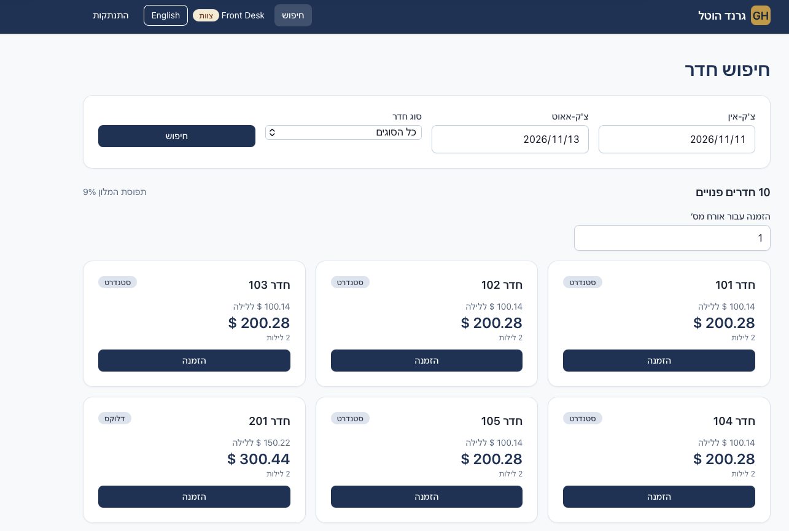
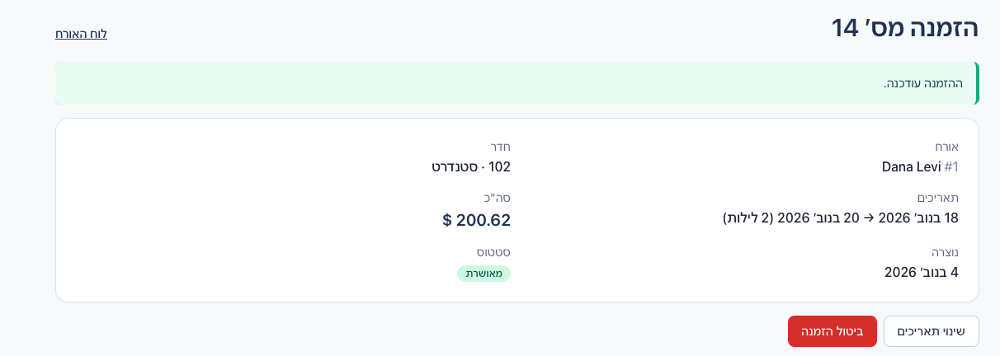
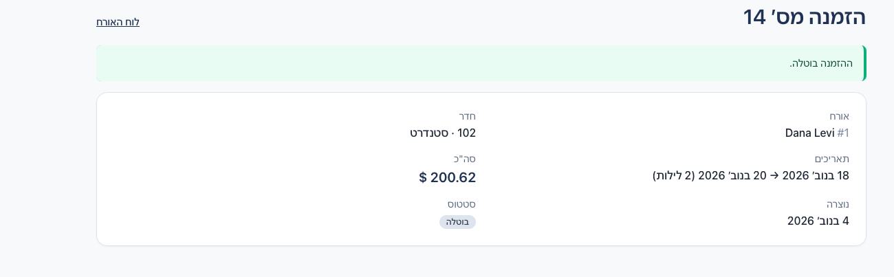
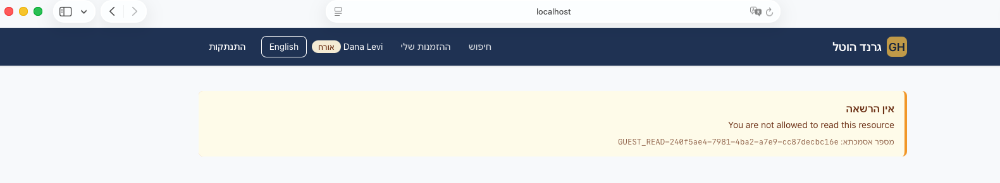
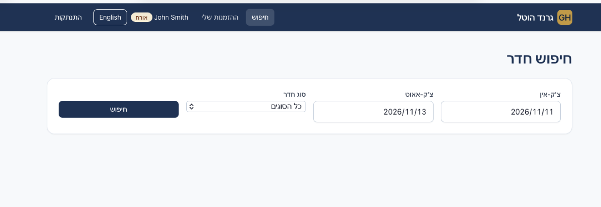

# Grand Hotel Booking Platform

[](https://github.com/samiba10/grand-hotel-booking/actions/workflows/ci.yml)

Hotel booking platform built as microservices: **Spring Boot 4 + Spring Cloud Gateway** backend,
**React + TypeScript + Tailwind** frontend (English / Hebrew RTL), PostgreSQL, Docker.

| Search with live pricing (staff) | Change dates (guest) | Cancel (guest) |
|---|---|---|
|  |  |  |

| RBAC feedback: guest 1 opens guest 2 (backend 403, with reference) | Hebrew (RTL) |
|---|---|
|  |  |

**Highlights:** gateway with AuthN + route-level AuthZ, permission-based RBAC in backend AND
frontend, transaction id + session id on every request and in the audit log, dynamic pricing with
a mocked FX service (integer money end to end), no double booking under 500 parallel requests,
99+ backend tests, k6 benchmarks, Docker, CI.

## Run it (Docker - the supported way)

Prerequisites: Docker Desktop. Nothing else.

```bash
cp .env.example .env        # optional: real secrets
docker compose up --build   # first build ~5 min, then seconds
```

| What | URL |
|---|---|
| Web app | http://localhost:3000 |
| API (gateway) | http://localhost:8080 |
| Swagger - booking | http://localhost:8082/swagger-ui.html |
| Swagger - auth / pricing / fx | :8081 / :8083 / :8084 `/swagger-ui.html` |

Demo users (dev only):

| User | Password | Role | Can |
|---|---|---|---|
| `guest1` | `Guest123!` | GUEST (Dana Levi, guest #1) | search, book / view / edit / cancel **own** bookings |
| `guest2` | `Guest123!` | GUEST (John Smith, guest #2) | same, for guest #2 |
| `staff` | `Staff123!` | STAFF | everything above for **any** guest |
| `admin` | `Admin123!` | ADMIN | staff + **audit log** |

```bash
./scripts/smoke-test.sh     # end-to-end API check (needs curl + jq)
```

## Develop without Docker

Java 21, Maven 3.9+, Node 20+.

```bash
mvn install -DskipTests     # once: installs common-lib for single-module runs
mvn verify                  # all tests + coverage reports
```

Start `fx-service`, `pricing-service`, `booking-service`, `auth-service`, `gateway-service` with
`mvn -pl services/<name> spring-boot:run` (H2 in memory, no database needed).

## Assignment notes (deliberate deviations)

| Assignment says | This project | Why |
|---|---|---|
| Entity Framework | **JPA / Hibernate + Flyway** (Java's ORM + migrations) | Same concepts on the Java/Spring stack ([ADR 1](docs/decisions.md)) |
| Static pricing, $100/night | **Base price = $100 equivalent** (370.00 ILS), then season x occupancy x live FX | Implements the *Pricing Microservice* bonus; set no seasons / one occupancy tier for static pricing |
| Bookings.TotalAmount | `total_amount_minor` (BIGINT) + `currency` + `fx_rate_used` | Integer money, no floating point ([Pricing & FX](docs/pricing-and-fx.md)) |
| Single microservice (Booking) | Booking + auth, pricing, fx behind a gateway | Gateway, pricing and RBAC bonuses; booking-service alone covers the core |

Full schema mapping: [Architecture - assignment mapping](docs/architecture.md#assignment-schema-mapping).

## Documentation

Everything else is in [`docs/`](docs/index.md) (served with `make docs`): architecture diagrams,
AuthN / AuthZ design, auditing, pricing & FX, API, tests, performance results, decisions.
