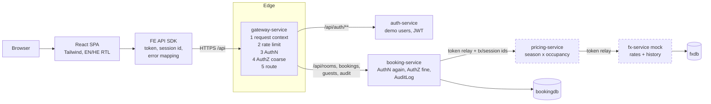
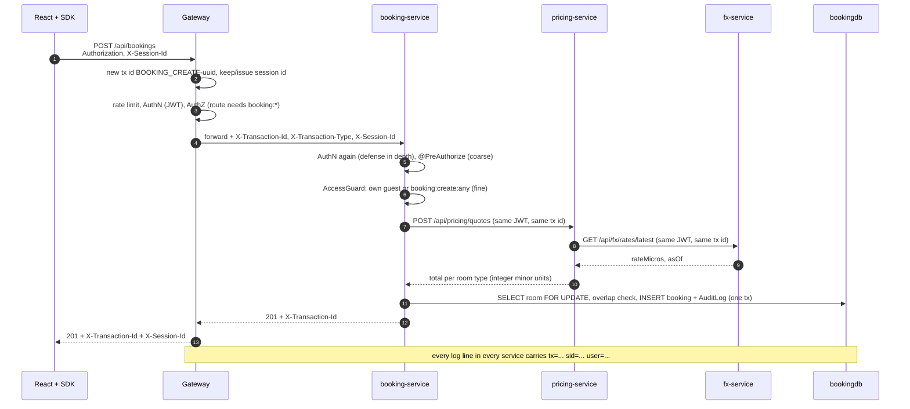
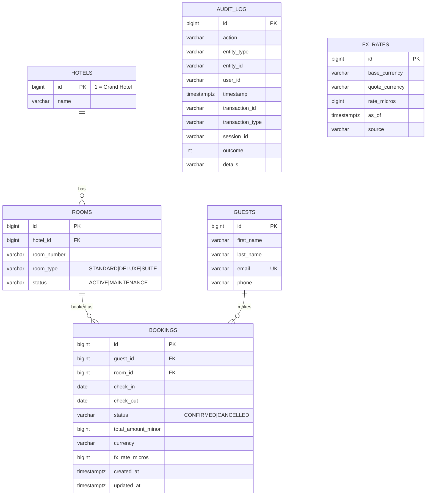

# Architecture

## Components

`pricing-service` and `fx-service` are **internal**: the gateway has no route to them.

| Module | Responsibility | Port (local) |
|---|---|---|
| `libs/common-lib` | AuthN, AuthZ, request context, `Money`, error model - auto-configured | - |
| `gateway-service` | Single entry point | 8080 |
| `auth-service` | Mock IdP: login, JWT, `/me` with permissions | 8081 |
| `booking-service` | Rooms, guests, bookings, availability, audit | 8082 |
| `pricing-service` | Dynamic price per night | 8083 |
| `fx-service` | Exchange rates (mock provider) | 8084 |
| `frontend` | React SPA | 5173 dev / 3000 docker |

## Request path

## Data model

`FX_RATES` lives in `fxdb` (database per service - no cross-service joins). Users are not in a
table: the assignment asks for hardcoded demo users; `guestId` in the JWT links an account to its
guest profile.

## How cross-cutting code is shared

| Concern | Written once in |
|---|---|
| Versions, plugins, coverage | root `pom.xml` |
| Servlet service dependencies | `services/service-parent/pom.xml` |
| JWT, permission resolution, `AccessGuard` | `common-lib` (auto-configuration) |
| Security filter chain, error handler, request context filter | `common-lib` |
| Role -> permission mapping, logging pattern, DB switch | `common-lib/common-defaults.yml` |
| Date rules for stays | `StayDates` (availability, create, update) |
| Container build | root `Dockerfile` with `SERVICE` build arg |
| Edge policy (public paths, route permissions, transaction types) | gateway `application.yml` |

