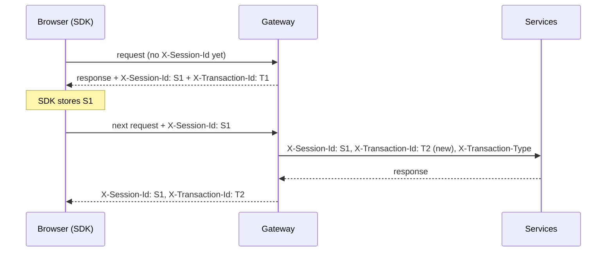

# Auditing: transaction id and session id

> As a system ops user, I want every request to include a transaction id and a session id and to
> be audited.

| Id | Created | Lifetime | Format |
|---|---|---|---|
| **Transaction id** | by the gateway, for **every** request; client values are overwritten | one request, across all services it touches | `<TYPE>-<uuid>`, e.g. `BOOKING_CREATE-6f1c...` |
| **Transaction type** | gateway, from `app.gateway.transaction-types` (method + path) | one request | `BOOKING_CREATE`, `ROOM_AVAILABILITY`, ... unknown -> `HTTP_<METHOD>` |
| **Session id** | gateway issues it on first contact; the client echoes it on every request (ping-pong) | sticky per browser, survives login/logout | UUID |



## Where the ids end up

1. **Every log line** of every service (`logging.pattern.level` in `common-defaults.yml`):
   `INFO [booking-service] [tx=BOOKING_CREATE-6f1c... type=BOOKING_CREATE sid=9a2e... user=guest1]`
2. **Gateway access log**, one line per request (also for 401/403/429 rejected at the edge):
   `tx=... type=... sid=... user=... method=POST path=/api/bookings status=201 durationMs=42`
3. **AuditLog table** (booking-service), two kinds of rows:
    - `HTTP_REQUEST` - every API request reaching the service, reads included, with HTTP outcome;
    - business events - `BOOKING_CREATED`, `BOOKING_UPDATED` (with before -> after),
      `BOOKING_CANCELLED`, written **in the same DB transaction** as the change.
4. **Error responses**: `ApiError.transactionId`, shown in the UI as a reference for support.
5. **Downstream calls**: `ContextPropagatingInterceptor` forwards both ids to pricing and fx.

## Querying

```bash
GET /api/audit?transactionId=BOOKING_CREATE-6f1c...   # everything one action did
GET /api/audit?sessionId=9a2e...                      # a user's whole journey
GET /api/audit?entityType=Booking&entityId=42         # history of one booking
```

Requires `audit:read` (ADMIN), enforced at the gateway and the endpoint.

## Limits (documented, not hidden)

- auth-service has no database: logins are audited in the gateway access log and service logs,
  not in AuditLog.
- In production, logs would be shipped as JSON to a central store (ELK / Loki) and AuditLog
  written via an outbox to an append-only store.
