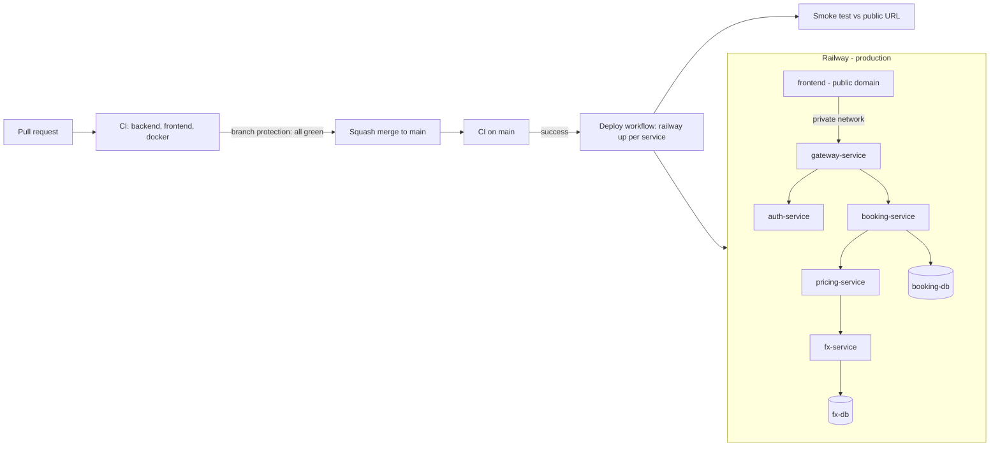

# Deployment (CI/CD to Railway)



| Piece | How |
|---|---|
| Build | the same Dockerfiles as local Docker: root `Dockerfile` with `SERVICE` (a Railway variable, passed as build arg because the Dockerfile declares `ARG SERVICE`), `frontend/Dockerfile` |
| Networking | only `frontend` has a public domain; the other services talk over Railway's private network (`<service>.railway.internal`) |
| Databases | two Railway Postgres instances - database per service, as in compose |
| Config | `scripts/railway-setup.sh` sets every variable; cross-service URLs are Railway reference variables (`${{fx-service.RAILWAY_PRIVATE_DOMAIN}}`) |
| nginx | config is a template (`API_UPSTREAM`), so one image runs in compose and on Railway |
| Secrets | `JWT_SECRET` generated once, stored only in Railway; `RAILWAY_TOKEN` (project token) as a GitHub secret |
| Release gate | branch protection requires CI on every PR; deploy runs only after a successful CI run on `main` |
| Verification | `scripts/smoke-test.sh` runs against the public URL after every deploy |
| Cost control | JVMs capped (`-Xmx256m`, SerialGC) |

## One-time setup

```bash
railway login && railway init --name grand-hotel
railway add --database postgres     # twice; rename to booking-db and fx-db in the dashboard
for s in fx-service pricing-service booking-service auth-service gateway-service frontend; do railway add --service "$s"; done
railway domain --service frontend
./scripts/railway-setup.sh
gh secret set RAILWAY_TOKEN          # Project Settings -> Tokens (production)
gh variable set PUBLIC_URL --body https://<frontend domain>
gh workflow run deploy.yml           # first deploy (later: automatic after CI on main)
```

## Lessons from the first deploy

| Symptom | Cause | Fix |
|---|---|---|
| `dockerfile invalid: --mount ... missing an id` | Railway's builder requires service-specific cache-mount ids | removed cache mounts; the go-offline layer caches dependencies |
| `jdbc:postgresql://:/` | variables set before the databases were renamed; references resolve by service name | rerun the idempotent `railway-setup.sh`, redeploy |
| nginx `no host in upstream ":8080"` | frontend deployed before the gateway reference resolved | redeploy every service holding a reference after variable changes |
| 500 from pricing: `StringIndexOutOfBoundsException` in `HttpURLConnection.getResponseCode()` | legacy JDK HTTP client failing on the private network | `java.net.http.HttpClient` (`JdkClientHttpRequestFactory`) for service-to-service calls |
| gateway not reachable privately | Netty binds IPv4 only | `SERVER_ADDRESS=::` |

Each was caught by the post-deploy smoke test; the 500 was traced with one transaction id across
gateway -> booking -> pricing logs.

## Rollback

Railway keeps previous deployments per service: Deployments -> pick one -> Redeploy. Or revert
the commit on `main`; the pipeline ships the revert.
