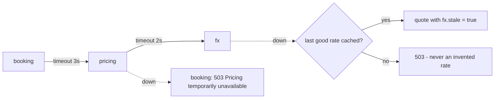

# Pricing and FX

## Money is an integer

All amounts are **BIGINT minor units**: `1002` = 10.02, `1050` = 10.50. Never `float`/`double`,
never `DECIMAL` in Java arithmetic, never a small integer column.

| Quantity | Representation | Example |
|---|---|---|
| Amount | `long` minor units + ISO currency (`Money`) | `Money(37000, "ILS")` = 370.00 ILS |
| Multiplier | basis points, 10000 = x1.00 | `13000` = +30% |
| FX rate | micros of quote per 1 base, 1000000 = 1.0 | ILS->USD `270270` = 0.270270 |

`Money` uses `Math.multiplyExact` / `addExact` (overflow throws instead of wrapping) and rounds
half away from zero in one place.

## Dynamic pricing (pricing-service)

```
night price = base(room type) x season(date) x occupancy(stay)     // in ILS minor units
converted   = night price x FX(ILS->USD)                            // per night
total       = sum of converted nights                               // lines always add up
```

- **Each night is priced separately**, so a stay crossing into summer pays summer rates only for
  summer nights.
- **Occupancy** = share of active rooms booked during the stay. booking-service computes it and
  sends it; pricing never reads bookings (no circular dependency between services).
- Rules are configuration (`app.pricing` in pricing-service): base prices, seasons (may wrap the
  year end), occupancy tiers. Baseline 370.00 ILS = ~$100, matching the assignment's "$100/night".
- The booking stores the total **and the FX rate used**, so any price can be explained later.

## FX service (mock)

There is **no exchange-rate constant in code**.

- Rates are rows in `fx_rates` (append-only history: `rate_micros`, `as_of`, `source`).
- The starting point is a Flyway seed (data), then a `FxRateProvider` moves it every 30 s. The
  mock provider is a bounded random walk (max 0.30% per step); a real provider (e.g. Bank of
  Israel) implements the same interface.
- The inverse pair is stored with each refresh.

## Failure handling



## Currency selection (USD / ILS)

| Who decides | Priority | Where |
|---|---|---|
| The user's explicit choice (header dropdown) | 1 | stored per browser, sent as `currency` |
| The user's region -> currency (admin mapping, e.g. `IL=ILS`) | 2 | region from `/api/auth/me`, else browser locale |
| The system default currency (admin) | 3 | `GET /api/settings` |

- **System settings** (`/api/settings`, ADMIN): which currencies are offered, the default, and
  region -> currency. Changed at runtime, audited (`SETTINGS_UPDATED`, before -> after).
- The admin can only offer currencies the pricing chain can quote
  (`app.booking.priceable-currencies`), so the UI can never offer a currency that would fail.
- **The server is the source of truth**: a currency that is not offered gets 400, whatever the UI
  sends.
- ILS quotes need no conversion (identity rate); USD quotes use the live FX rate.
