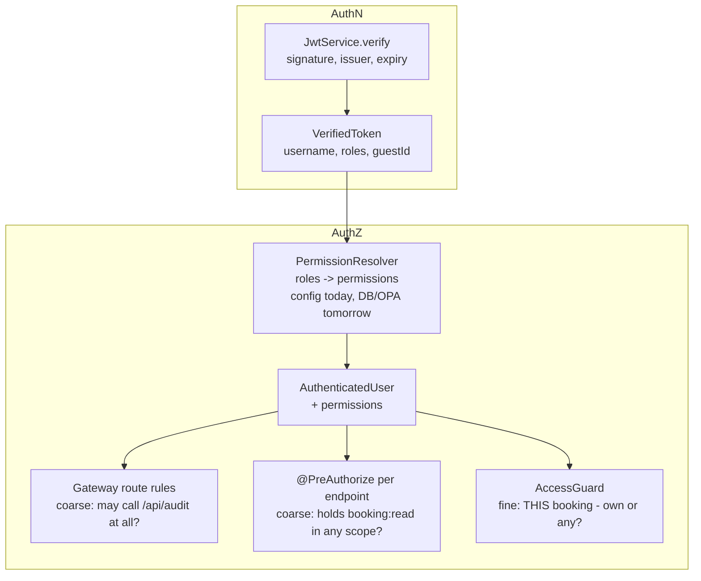
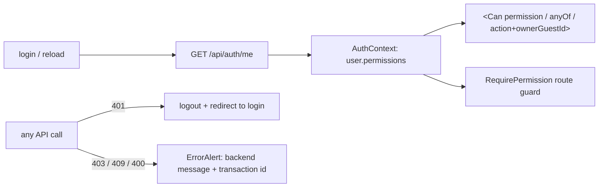

# Security: AuthN, AuthZ, RBAC

AuthN ("who are you?") and AuthZ ("what may you do?") are **separate, replaceable layers**, and
each is enforced at more than one point.

| Layer | Where | Swappable by |
|---|---|---|
| AuthN | `JwtService` (gateway + every service) | an OIDC resource-server config |
| Permission resolution | `PermissionResolver` bean | declaring another bean |
| Coarse, per route | gateway `app.gateway.route-permissions` | configuration |
| Coarse, per endpoint | `@PreAuthorize("hasAnyAuthority(...)")` | annotation |
| Fine, per resource | `AccessGuard.require(user, action, ownerGuestId)` | code (one class) |

## Permission matrix

Permissions are `<resource>:<action>[:<scope>]`; scope `own` = resources of the caller's guest
profile, `any` = all. Defined once in `common-defaults.yml`; code never checks role names.

| Permission | GUEST | STAFF | ADMIN |
|---|:-:|:-:|:-:|
| `room:read` | ✅ | ✅ | ✅ |
| `pricing:quote` | ✅ | ✅ | ✅ |
| `booking:create / read / update / cancel` | `:own` | `:any` | `:any` |
| `guest:read` | `:own` | `:any` | `:any` |
| `audit:read` | | | ✅ |
| `fx:read` | | | ✅ |
| `settings:write` | | | ✅ |

Adding e.g. a `MANAGER` role = one block of YAML. No code change.

## Defense in depth

- The gateway rejects missing/invalid tokens (401) and forbidden routes (403) before any service.
- Every service re-verifies the JWT: a service reached directly (bypassing the gateway) is still
  protected.
- Service-to-service calls relay the **user's** token, so pricing and fx authorize the real user
  (zero trust), and the audit trail shows who triggered them.
- `X-Auth-User` from clients is stripped at the edge; services never use it for decisions.
- Ownership denials return 403 with a clear message and the transaction id.

## Other controls

| Control | Implementation |
|---|---|
| Password storage | BCrypt; login runs BCrypt even for unknown users (no username enumeration by timing) |
| Weak JWT secret | startup fails if `JWT_SECRET` < 32 bytes |
| Stateless API | no sessions, no cookies -> CSRF disabled on purpose |
| CORS | configured once at the gateway |
| Rate limiting | per-client token bucket at the edge, 429 + `Retry-After` |
| Body size | 1 MB limit at the gateway |
| Error leakage | no stack traces / SQL in responses; generic 500 message |
| Log injection | transaction / session ids accepted only from a strict character set |
| Containers | non-root user, read-only filesystem, `no-new-privileges` |

## Frontend RBAC (driven by backend feedback)

- The UI never derives permissions from role names: **permissions come from the backend**
  (`/api/auth/me`, also returned by login). A stored token is re-validated with `/me` on reload.
- `rbac.ts` mirrors the backend vocabulary; `canOn(user, 'booking:update', guestId)` applies the
  same own/any rule as `AccessGuard`.
- `<Can>` hides controls the user cannot use (Book, Change dates, Cancel, Audit nav);
  `RequirePermission` explains a forbidden page instead of rendering a blank screen.
- Hiding is UX, not security: if a user forces a call (e.g. opens `/guest/2` as guest 1), the
  backend answers 403 and `ErrorAlert` shows its explanation and the transaction id.
- Staff (`booking:create:any`) get a "book for guest #" field; guests always book for themselves.
